<!-- README.md is generated from README.Rmd. Please edit that file -->

# functionsStyleguide

<!-- badges: start -->

<!-- badges: end -->

Das Package **functionsStyleguide** enthält die Farbpalette gemäss
Styleguide des Amts für Daten und Statistik sowie einige Funktionen für
ggplot-Grafiken gemäss <a
href="https://posit-connect.tg.ch/content/cede7492-b81a-42f0-92f4-b0ecd3e16f56"
target="_blank">Styleguide</a>.

## Installation über Github

``` r
# install.packages("devtools")
devtools::install_github("https://github.com/stat-tg/functionsStyleguide.git")
```

## Nutzung der Farbpaletten

Im Package sind verschieden Palettensammlungen hinterlegt, die direkt in
den ggplot-Funktionen verwendet werden können, je für die Füllfarben und
die Farben für die Ränder (bei Balken, Säulen oder Flächen).

Hier ein Überblick über die verschiedenen Palettensammlungen mit den
jeweiligen Paletten:

### maincolors_discrete

Die Palettensammlung `maincolors_discrete`enthält die Hauptfarben für
kategoriale Variablen (`fillColor`) sowie eine Palette mit den
Highlight-Farben für Linien und Hervorhebungen (`fillHighlight`)sowie
eine Palette mit dem Hauptblau und verschiedenen Grautönen
(`fillBlueGreys`).

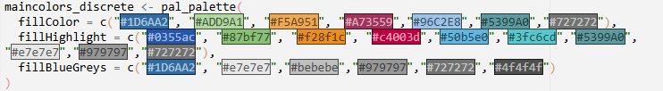

### border_discrete

Die Palettensammlung`border_discrete` ergänzt die Palettensammlung
`maincolors_discrete` für jene Grafiken, wo eine Umrandung in dunklerer
Farbe ergänzt wird (z.B. Balken, Säulen, Flächen): Umrissfarben für
kategoriale Variablen (`borderColor`), eine Palette mit den
Highlight-Farben für Linien und Hervorhebungen (`borderHighlight`)sowie
eine Palette mit dem Hauptblau und verschiedenen Grautönen
(`borderBlueGreys`).

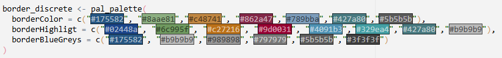

### colors_sequential

Die Palettensammlung`colors_sequential` enthält Farbpaletten für
sequentielle Daten, je nach Anzahl der Kategorien, sowohl in den Haupt-
wie auch in den Highlightfarben.

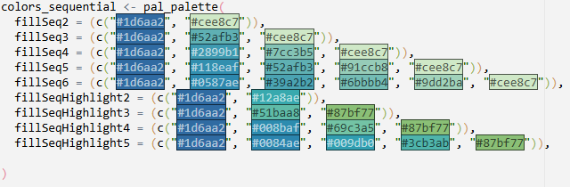

### border_sequential

Die Palettensammlung`border_sequential` ergänzt die Palettensammlung
`colors_sequential` für jene Grafiken, wo eine Umrandung in dunklerer
Farbe ergänzt wird (z.B. Balken, Säulen, Flächen).

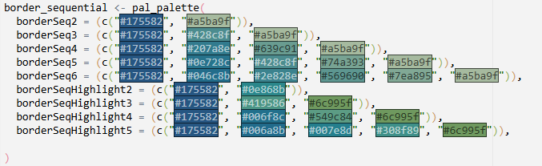

### colors_divergent

Die Palettensammlung`colors_divergent` enthält Farbpaletten für
divergierende Daten, je nach Anzahl der Kategorien, sowohl in den Haupt-
wie auch in den Highlightfarben sowie mit oder ohne neutralen
Mittelwert.

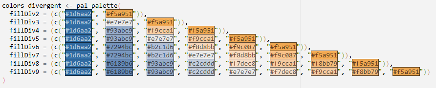

### border_divergent

Die Palettensammlung`border_divergent` ergänzt die Palettensammlung
`colors_divergent` für jene Grafiken, wo eine Umrandung in dunklerer
Farbe ergänzt wird (z.B. Balken, Säulen, Flächen).

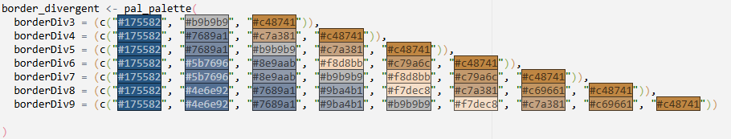

### party_colors

Die Palettensammlung`party_colors` enthält die Farben, welche für die
grösseren Parteien im Kanton Thurgau verwendet werden. Die Palette
basiert auf den Farben, wie sie bspw.
<a href="https://github.com/srfdata/swiss-party-colors"
target="_blank">SRF</a> in ihren Grafiken verwendet.

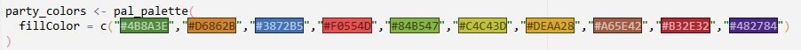 <br>  
**Zuordnung zu Parteien**:  
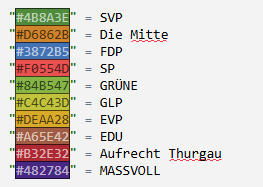

### colors_gender

Die Palettensammlung`colors_gender` enthält die Farben für Grafiken mit
Daten zu Männern und Frauen. Die Farben basieren auf denjeningen, die
das BFS für geschlechterbezogenen Grafiken verwendet.

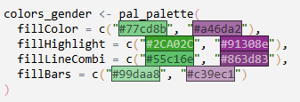

### border_gender

Die Palettensammlung`border_gender` ergänzt die Palettensammlung
`colors_gender` für jene Grafiken, wo eine Umrandung in dunklerer Farbe
ergänzt wird (z.B. Balken, Säulen, Flächen).

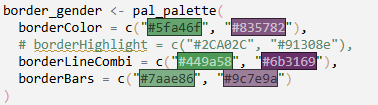

### colors_regions

Die Palettensammlung`colors_regions` enthält Farben für Grafiken, wo
nebst dem Thurgau auch Daten zu anderen Regionen resp. der Gesamtschweiz
dargestellt werden, je mit einer Hauptfarbe und einer Highlightfarbe für
Liniendiagramme.

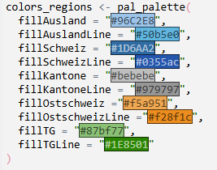

### border_regions

Die Palettensammlung`border_regions` ergänzt die Palettensammlung
`colors_regions` für jene Grafiken, wo eine Umrandung in dunklerer Farbe
ergänzt wird (z.B. Balken, Säulen, Flächen).

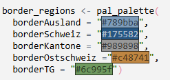

## Beispiele

Das Package enthält Funktionen für die gängisten Grafiktypen
entsprechend den Vorgaben im Styleguide mittels ggplot2-Package. Die
Funktionen setzen im Normalfall einen Datensatz im long format voraus,
mit einer Variable im Character Format für die x-Achse (`x`) und einer
nummerischen Variable auf der y-Achse (`y`) und . Titel (`title`) und
Untertitel (`subtitle`) können optional mitgegeben werden. Unten links
wird jeweils in der ersten Zeile per Default die Angabe zum Ersteller,
also “Amt für Daten und Statistik” abgebildet, darunter kann die genaue
Datenquelle (`source`) ergänzt werden.

``` r
# library(functionsStyleguide)
```

### Balkendiagramme

##### Einfaches Balkendiagramm, Farbauswahl aus der Palette `fillColor` in `maincolors_discrete`

``` r
ggplot_bar(data = tab_bev, 
           y = "n", 
           x = "jahr",
           title = "Bevölkerung wird älter", 
           subtitle = "Kanton Thurgau, Ständige Wohnbevölkerung nach Altersklassen, 2015-2025",
           source = "Kantonale Bevölkerungsstatistik", 
           fill_color = 2, 
           border_color = 2)
```

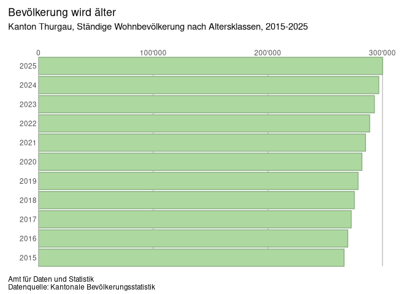

## <br>

<br>

##### Einfaches Balkendiagramm mit Highlight-Farbe für eine Kategorie (bspw. Jahr)

``` r
ggplot_bar(data=tab_bev,
           x = "jahr", y = "n",
           title = "Bevölkerung wird älter", subtitle = "Kanton Thurgau, Ständige Wohnbevölkerung nach Altersklassen, 2015-2025",
           source = "Kantonale Bevölkerungsstatistik",
           fill_colors = c(
             "2015" = "#bebebe",
             "2016" = "#bebebe",
             "2017" = "#bebebe",
             "2018" = "#bebebe",
             "2019" = "#bebebe",
             "2020" = "#bebebe",
             "2021" = "#0355ac",
             "2022" = "#bebebe",
             "2023" = "#bebebe",
             "2024" = "#bebebe",
             "2025" = "#bebebe"
           ),
           border_colors = c(
             "2015" = "#989898",
             "2016" = "#989898",
             "2017" = "#989898",
             "2018" = "#989898",
             "2019" = "#989898",
             "2020" = "#989898",
             "2021" = "#02448a",
             "2022" = "#989898",
             "2023" = "#989898",
             "2024" = "#989898",
             "2025" = "#989898"
           )
)
```

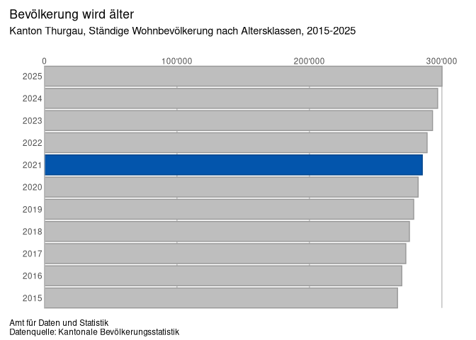

## <br>

<br>

##### Einfaches Balkendiagramm mit zweiter Farbe der Palette `fillColor` resp. `borderColor` aus den Palettensammlungen `maincolors_discrete` resp. `border_discrete` inkl. Werte-Labels

``` r
ggplot_bar_full(
  data = tab_alterskat %>% filter(alterskat_det=="25-39"),
  y = "n",
  x = "jahr",
  title = "TITEL",
  subtitle = "UNTERTITEL",
  fill = NULL,
  color = NULL,
  fill_color = 2,
  border_color = 2,
  labels = TRUE
)
```

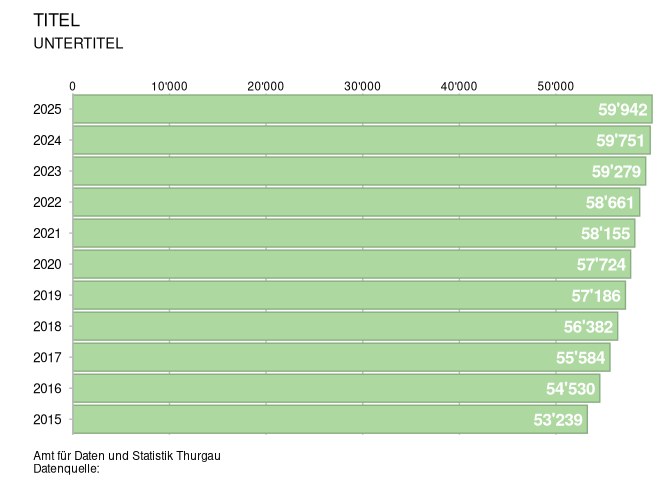

## <br>

<br>

##### Gruppiertes Balkendiagramm mit Hauptfarben aus den Palettensammlungen `maincolors_discrete` resp. `border_discrete`

``` r
ggplot_bar_full(
  data = tab_alterskat,
  y = "n",
  x = "jahr",
  fill = "alterskat_det",
  fill_palette = maincolors_discrete,
  fill_palette_name = "fillColor",
  border_palette = border_discrete,
  border_palette_name = "borderColor",
  position = "dodge"
)
```


## <br>

<br>

##### Gestapeltes Balkendiagramm mit Hauptfarben aus den Palettensammlungen `maincolors_discrete` resp. `border_discrete` (Defaultpaletten)

``` r
ggplot_stacked_bar(data = tab_alterskat, 
                   y = "jahr", 
                   x = "n", 
                   fill = "alterskat_det", 
                   colour = "alterskat_det",
                   title = "Bevölkerung wird älter", 
                   subtitle = "Kanton Thurgau, Ständige Wohnbevölkerung nach Altersklassen, 2015-2025",
                   source = "Kantonale Bevölkerungsstatistik", 
                   order_by = "order", 
                   decreasing = FALSE,
                   reverse_fill = TRUE, 
                   reverse_color = TRUE)
```

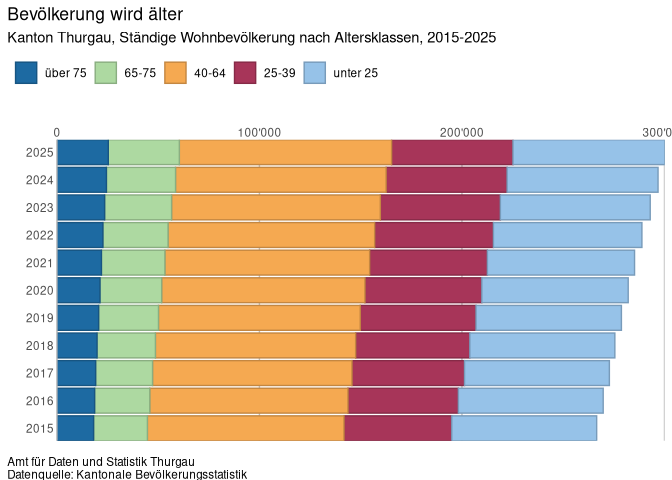

## <br>

<br>

##### Gruppierte Balkendiagramm mit Farben aus der sequentiellen Farbpalettensammlung `colors_sequential` resp. `border_sequential` für Variable mit 5 Kategorien

``` r
ggplot_grouped_bar_palette(
  data = tab_alterskat,
  x = "jahr",
  y = "n",
  fill = "alterskat_det",
  color = "alterskat_det",
  order = "order",
  fill_palette = colors_sequential,
  fill_palette_name = "fillSeq5",
  border_palette = border_sequential,
  border_palette_name = "borderSeq5",
  title = "Bevölkerung wird älter", subtitle = "Kanton Thurgau, Ständige Wohnbevölkerung nach Altersklassen, 2015-2025",
  source = "Kantonale Bevölkerungsstatistik"
)
```

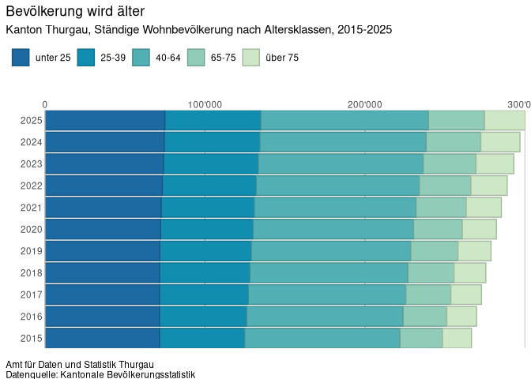

## <br>

<br>

##### Einfaches Balkendiagramm mit Vertrauensintervallen

``` r
ggplot_bar_vi(
  data = tab_bildung_tot,
  y = "ausbildung_5cat",
  x = "anteil",
  ci_lower = "ci_l_pr",
  ci_upper = "ci_u_pr",
  title = "Bevölkerung wird älter",
  subtitle = "Kanton Thurgau, Ständige Wohnbevölkerung nach Altersklassen, 2015–2025",
  source = "Kantonale Bevölkerungsstatistik",
  fill_color = 2,
  border_color = 2,
  y_label_wrap = 20
)
```

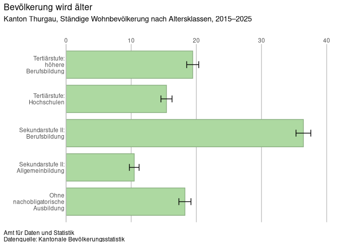

## <br>

<br>

##### Gruppiertes Balkendiagramm mit Vertrauensintervallen und geschlechterspezifischen Farben

``` r
ggplot_bar_vi(
  data = tab_bildung_sex_full %>% filter(sex!="Total"),
  y = "ausbildung_5cat",
  x = "anteil",
  group = "sex",
  ci_lower = "ci_l_pr",
  ci_upper = "ci_u_pr",
  title = "Bildung nach Geschlecht",
  subtitle = "Kanton Thurgau, 2024",
  source = "Kantonale Bevölkerungsstatistik",
  fill_palette = colors_gender,
  fill_palette_name = "fillColor",
  border_palette = border_gender,
  border_palette_name = "borderColor",
  y_label_wrap = 20
)
```


## <br>

<br>

### Säulendiagramme

##### Einfaches Säulendiagramm mit der ersten Farbe aus den Farbpalettensammlungen mit den Hauptfarben `maincolors_discrete` resp. `border_discrete` (Default-Paletten)

``` r
ggplot_column_full(data = tab_bev,
              x = "jahr",
              y = "n",
              title = "TITEL",
              subtitle = "UNTERTITEL",
              source = "Kantonale Bevölkerungsstatistik",
              fill_color = 1,
              border_color = 1)
```

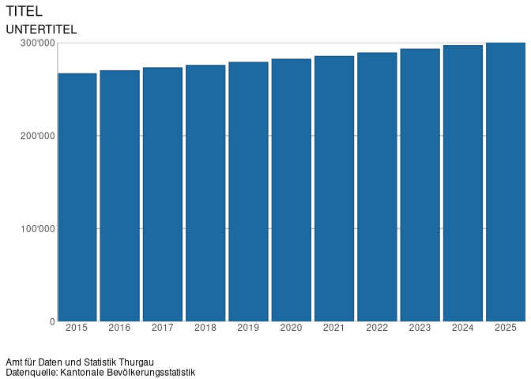

## <br>

<br>

##### Gestapeltes Säulendiagramm mit den Farben aus den Farbpalettensammlungen mit den Hauptfarben `maincolors_discrete` resp. `border_discrete` (Default-Paletten)

``` r
ggplot_stacked_column(
  data = tab_alterskat_3cat,
  x = "jahr",
  y = "n",
  fill = "alterskat",
  color = "alterskat",
  title = "TITEL",
  subtitle = "UNTERTITEL",
  source = "Kantonale Bevölkerungsstatistik"
)
```

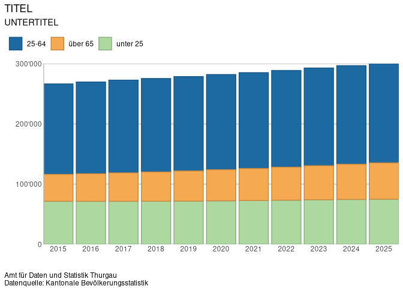

## <br>

<br>

##### Gruppiertes Säulendiagramm in den Farben aus den Palettensammlungen mit den Hauptfarben `maincolors_discrete` resp. `border_discrete` (Default-Paletten)

``` r
ggplot_grouped_column(
  data = tab_alterskat,
  x = "jahr",
  y = "n",
  fill = "alterskat_det",
  color = "alterskat_det",
  title = "TITEL",
  subtitle = "UNTERTITEL",
  source = "Kantonale Bevölkerungsstatistik"
)
```

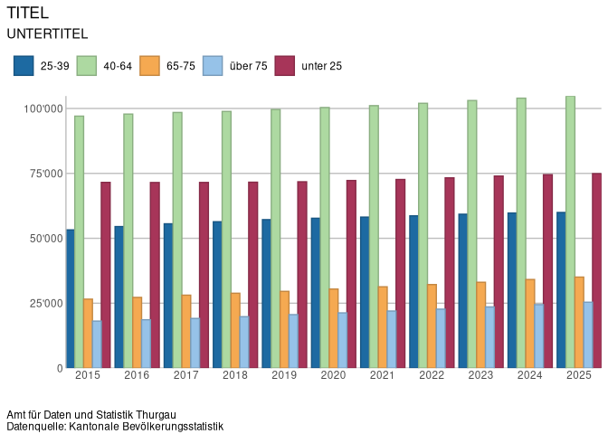

## <br>

<br>

##### Einfaches Säulendiagramm mit Werte-Labels

``` r
ggplot_column_full(
  data = tab_bev,
  y = "n",
  x = "jahr",
  title = "TITEL",
  subtitle = "UNTERTITEL",
  source = "Kantonale Bevölkerungserhebung",
  labels = TRUE,
  label_color = "white",
  label_angle = 90,
  label_hjust = 1.5,
  label_vjust = 0.5
)
```


## <br>

<br>

##### Gestapeltes Balkendiagramm mit sequentieller Farbpalette und Werte-Labels

``` r
ggplot_column_full(
  data = tab_alterskat,
  y = "n",
  x = "jahr",
  fill = "alterskat_det",
  color = "alterskat_det",
  title = "TITEL",
  subtitle = "UNTERTITEL",
  fill_palette = colors_sequential,
  fill_palette_name = "fillSeq5",
  border_palette = border_sequential,
  border_palette_name = "borderSeq5",
  position = "stack",
  labels = TRUE
)
```

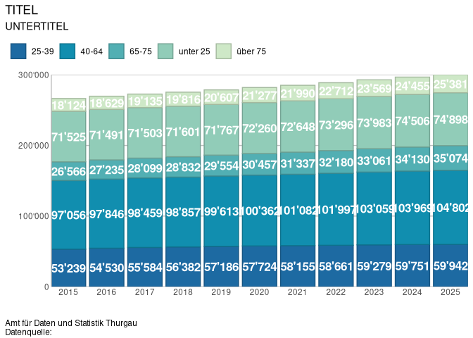

## <br>

<br>

##### Gruppiertes Balkendiagramm mit sequentieller Farbpalette

``` r
ggplot_column_full(
  data = tab_alterskat,
  y = "n",
  x = "jahr",
  title = "TITEL",
  subtitle = "UNTERTITEL",
  fill = "alterskat_det",
  color = "alterskat_det",
  fill_palette = colors_sequential,
  fill_palette_name = "fillSeq5",
  border_palette = border_sequential,
  border_palette_name = "borderSeq5",
  position = "dodge"
)
```

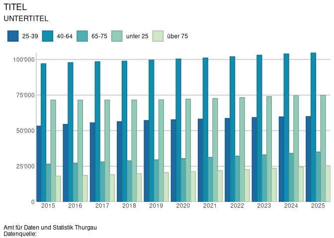

## <br>

<br>

##### Säulendiagramm mit Vertrauensintervallen und zweiter Farbe aus den Paletten `fillColors` resp. `borderColor` für die Hauptfarben

``` r
ggplot_column_vi(
  data = tab_bildung_tot,
  y = "ausbildung_5cat",
  x = "anteil",
  ci_lower = "ci_l_pr",
  ci_upper = "ci_u_pr",
  title = "Bevölkerung wird älter",
  subtitle = "Kanton Thurgau, Ständige Wohnbevölkerung nach Altersklassen, 2015-2025",
  source = "Kantonale Bevölkerungsstatistik",
  fill_color = 2,
  border_color = 2,
  y_label_wrap = 20
)
```

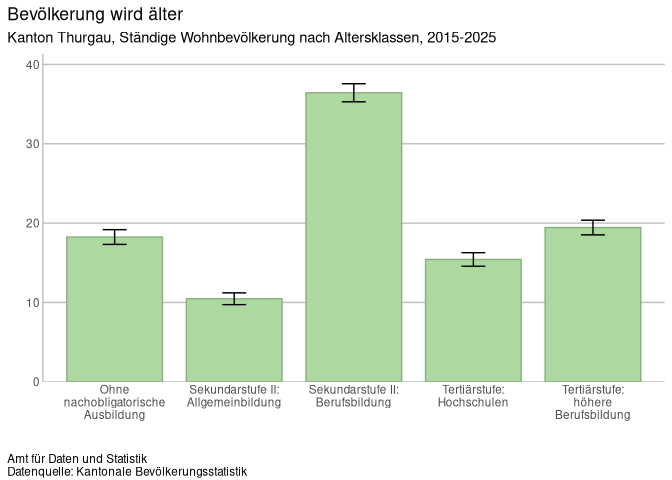

## <br>

<br>

##### Säulendigramm mit gruppierten Balken und Vertrauensintervallen inkl. Auswahl der Farbpaletten

``` r
ggplot_column_vi(
  data = tab_bildung_sex_full, #%>% filter(sex!="Total"),
  y = "ausbildung_5cat",
  x = "anteil",
  group = "sex",
  ci_lower = "ci_l_pr",
  ci_upper = "ci_u_pr",
  title = "Bildung nach Geschlecht",
  subtitle = "Kanton Thurgau",
  source = "Kantonale Bevölkerungsstatistik",
  fill_palette = maincolors_discrete,
  fill_palette_name = "fillColor",
  border_palette = border_discrete,
  border_palette_name = "borderColor",
  y_label_wrap = 20
)
```

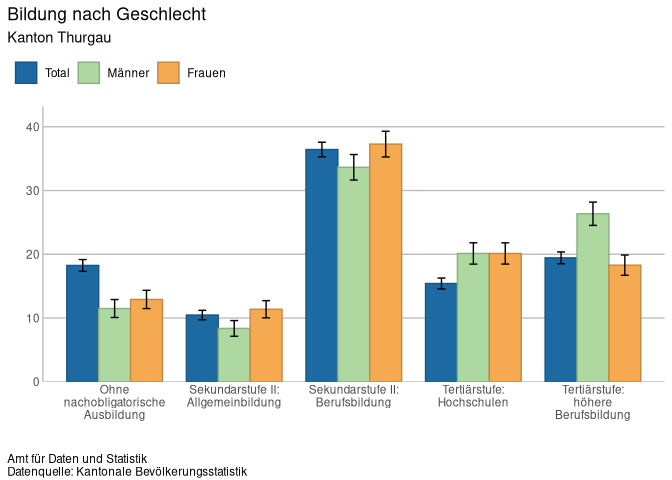

## <br>

<br>

### Liniendiagramme

##### Liniengrafik mit einer Linie

``` r
ggplot_line_full(
  data = tab_bev,
  x = "jahr",
  y = "n",
  line_color = 1,
  title = "Bevölkerung",
  subtitle = "Entwicklung über die Zeit",
  source = "Kantonale Bevölkerungserhebung"
)
```


## <br>

<br>

##### Liniengrafik mit mehreren Linien für die Kategorien in den Hauptfarben aus den Paletten `fillHighlight` resp. `borderHighlight`

``` r
ggplot_line_full(
  data = tab_alterskat,
  x = "jahr",
  y = "n",
  group = "alterskat_det",
  line_color = 1,
  title = "Bevölkerung",
  subtitle = "Entwicklung über die Zeit",
  source = "Kantonale Bevölkerungserhebung",
  y_min = 0,
  y_max = 150000,
  theme = theme_opts_line_minor_grid
)
```

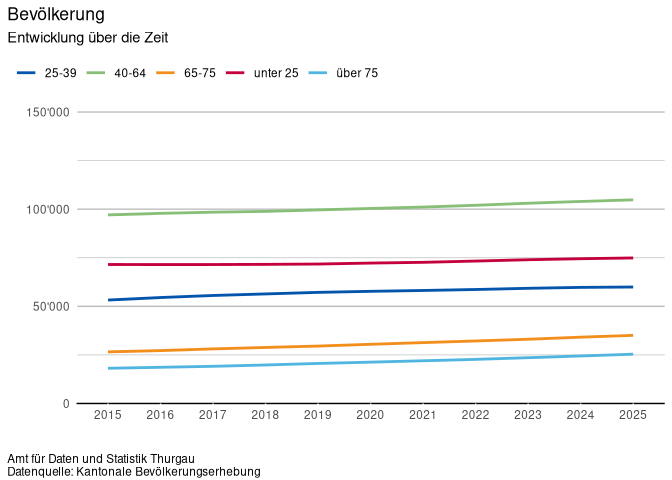

## <br>

<br>

##### Liniengrafik mit mehreren Linien für die Kategorien mit Farben aus der sequentiellen Palettensammlung `colors_sequential` und Kategorienlabels

``` r
ggplot_line_full(
  data = tab_alterskat,
  x = "jahr",
  y = "n",
  order = "order",
  group = "alterskat_det",
  line_labels = TRUE,
  line_label_size = 4,
  line_label_nudge_x = 0.2,
  group_palette = colors_sequential,
  group_palette_name = "fillSeq5",
  title = "Bevölkerung nach Alterskategorie",
  subtitle = "Entwicklung über die Zeit",
  source = "Kantonale Bevölkerungserhebung",

)
```

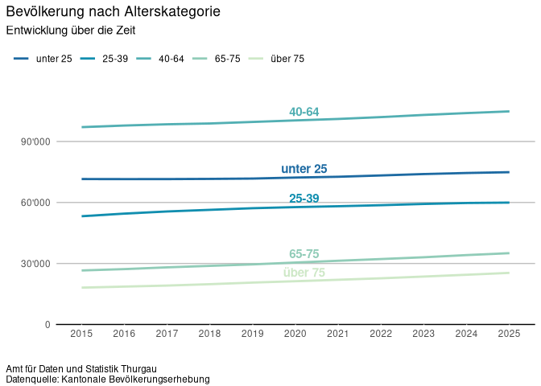

## <br>

<br>

##### Liniengrafik mit Vertrauensintervallen als Bandbreite

``` r
ggplot_line_vi(
  data = tab_erwerbsquote %>%
    dplyr::mutate(jahr = as.character(jahr)) %>% filter(sex!="Total"),
  x = "jahr",
  y = "anteil",
  group = "sex",

  group_palette = colors_gender,
  group_palette_name = "fillColor",

  title = "Bevölkerung",
  subtitle = "Entwicklung über die Zeit",
  source = "Kantonale Bevölkerungserhebung",

  ci_lower = "ci_l_pr",
  ci_upper = "ci_u_pr",

  ribbon_alpha = 0.30
)
```

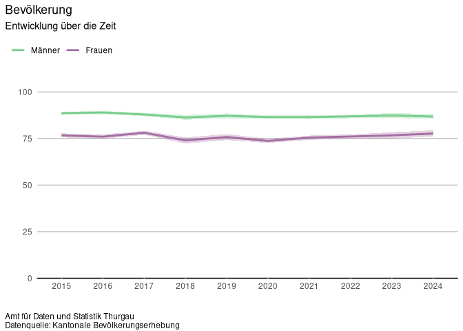

## <br>

<br>

##### Liniengrafik mit Vertrauensintervallen und Kategorien-Labels

``` r
ggplot_line_vi(
  data = tab_erwerbsquote %>%
    dplyr::mutate(jahr = as.character(jahr)) %>% filter(sex!="Total"),
  x = "jahr",
  y = "anteil",
  group = "sex",

  group_palette = colors_gender,
  group_palette_name = "fillColor",

  title = "Bevölkerung",
  subtitle = "Entwicklung über die Zeit",
  source = "Kantonale Bevölkerungserhebung",

  ci_lower = "ci_l_pr",
  ci_upper = "ci_u_pr",

  ribbon_alpha = 0.30,
  line_labels = TRUE
)
```

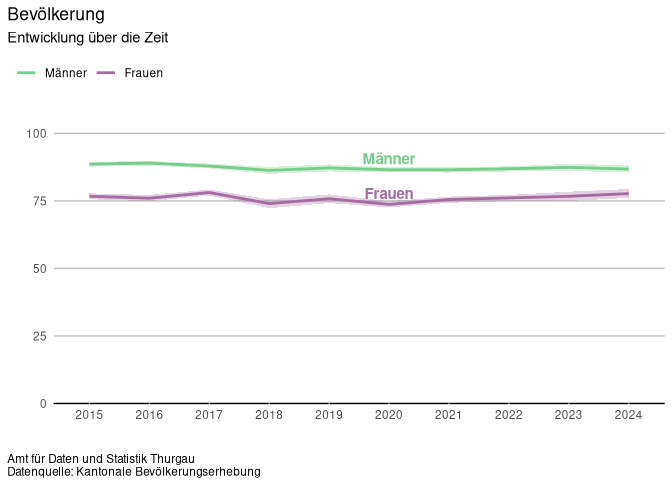

## <br>

<br>

### Donutdiagramme

##### Einfache Donut-Grafik mit Hauptfarben und Wertelabels sowie Möglichkeit, über `filter_value` eine Auswahl zu treffen

``` r
ggplot_donut_full(data = tab_alterskat,
                  filter_value = "2025",
                  x = "jahr",
                  y = "n",
                  fill_cat = "alterskat_det",
                  title = "TITEL",
                  subtitle = "Untertitel",
                  hsize = 1,
                  order = "order",
                  source = "Kantonale Bevölkerungsstatistik")
```

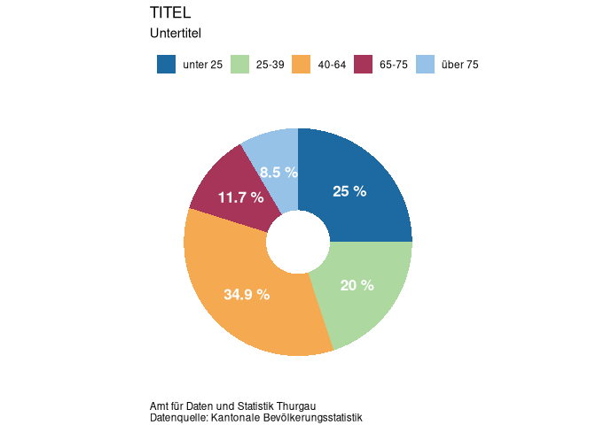

------------------------------------------------------------------------

##### Einfache Donut-Grafik mit sequentieller Farbpalette

``` r
ggplot_donut_full(data = tab_alterskat,
             filter_value = "2025",
             x = "jahr",
             y = "n",
             fill_cat = "alterskat_det",
             title = "TITEL",
             subtitle = "Untertitel",
             hsize = 1,
             palette = colors_sequential,
             palette_name = "fillSeq5",
             source = "Kantonale Bevölkerungsstatistik")
```

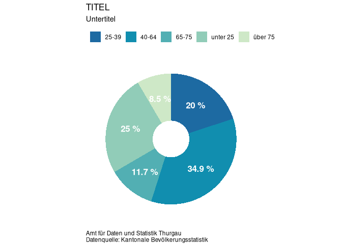

## <br>

<br>

##### Einfache Donut-Grafik mit Highlightfarbe für Hauptkategorie und Grautönen für übrige Kategorien aus der Palettensammlung `maincolors_discrete` resp. der Palette `fillBlueGreys`

``` r
ggplot_donut_full(data = tab_alterskat,
             filter_value = "2025",
             x = "jahr",
             y = "n",
             order = "order",
             start_category = "unter 25",
             fill_cat = "alterskat_det",
             title = "TITEL",
             subtitle = "Untertitel",
             hsize = 1,
             palette = maincolors_discrete,
             palette_name = "fillBlueGreys",
             source = "Kantonale Bevölkerungsstatistik")
```


## <br>

<br>

### Karten

##### Karte für kategorische Variablen mit divergierender Farbpalette

``` r
ggplot_map(
  data = tab_steuerfuss,
  # var_gemeinde = "gemeinde",
  # var_bfs = "bfs_nr",
  var_value = "gemeindesteuerfuss",
  label_value = "Gemeindesteuerfuss in %",
  palette = colors_divergent,
  palette_name = "fillDiv5",
  category_labels = c(
    "30-39 %",
    "40–49 %",
    "50–59 %",
    "60–69 %",
    "70–72 %"
  ),
  title = "Wenige Steuerfüsse über 70 %",
  subtitle = "Kanton Thurgau, 2026, Gemeindesteuerfüsse nach Kategorien",
  source = "Steuerverwaltung Thurgau"
)
```

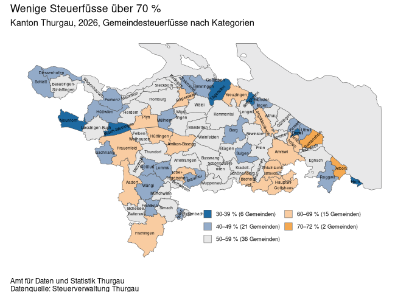

## <br>

<br>

##### Karte für kategorische Variablen mit sequentieller Farbpalette

``` r
ggplot_map(
  data = tab_steuerfuss,
  var_gemeinde = "gemeinde",
  var_value = "gemeindesteuerfuss",
  label_value = "Gemeindesteuerfuss in %",
  palette = colors_sequential,
  palette_name = "fillSeq5",
  category_labels = c(
    "30-39 %",
    "40–49 %",
    "50–59 %",
    "60–69 %",
    "70–72 %"
  ),
  source = "Steuerverwaltung Thurgau"

)
```

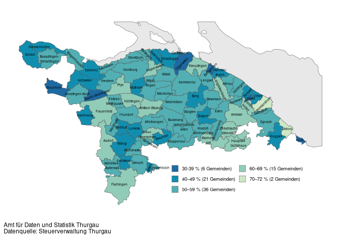

## <br>

<br>

##### Karte für kategorische Variablen drei Kategorien und Hauptfarben

``` r
ggplot_map(data = tab_prop_ev,
           # var_gemeinde = "gemeinde_name",
           # var_bfs = "bfs_nr_gemeinde",
           var_value = "proportion",
           label_value = "Anteil Evangelisch-reformiert",
           category_labels = c(
             "Anteil unter 20 %",
             "Anteil zw. 20 und 35 %",
             "Anteil über 35 %"
           ),
           source = "Kantonale Bevölkerungsstatistik",
           legend_ncol = 1

)
```

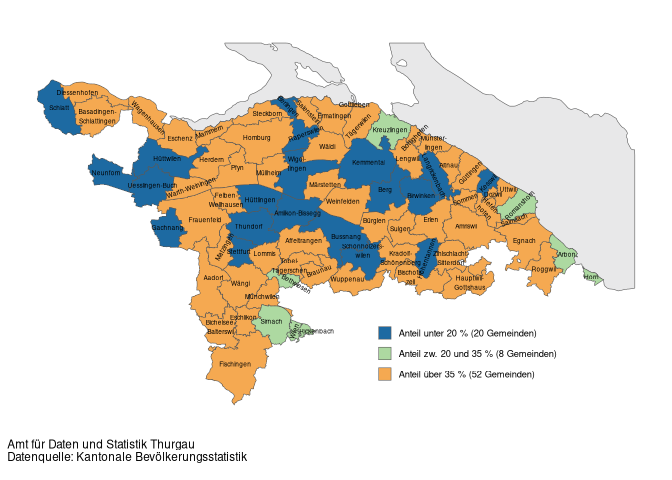

## <br>

<br>

### Flächendiagramme (Area)

##### Flächen- resp. Area-Grafik mit sequentieller Farbpalette

``` r
ggplot_area_full(
  data = tab_alterskat_area,
  x = "jahr",
  y = "n",
  order = "order",
  group = "alterskat_det",
  area_labels = FALSE,
  group_palette = colors_sequential,
  group_palette_name = "fillSeq5",
  border_palette = border_sequential,
  border_palette_name = "borderSeq5",
  title = "Bevölkerung nach Alterskategorie",
  subtitle = "Entwicklung über die Zeit",
  source = "Kantonale Bevölkerungserhebung",

)
```

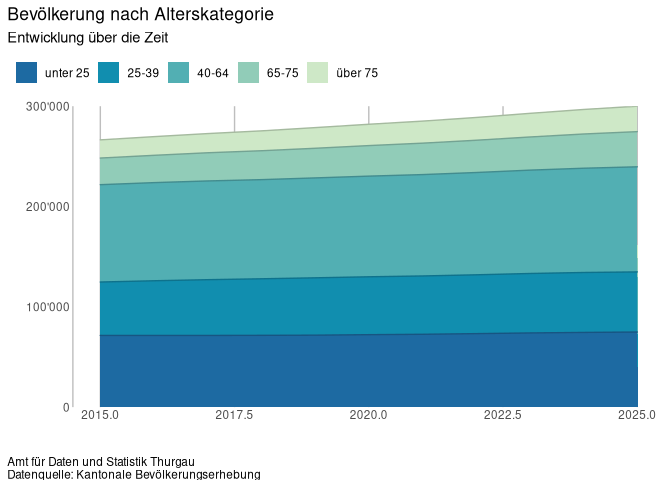

## <br>

<br>

##### Flächen- resp. Area-Grafik mit Hauptfarben und Kategorienlabels

``` r
ggplot_area_full(
  data = tab_alterskat_area,
  x = "jahr",
  y = "n",
  order = "order",
  group = "alterskat_det",
  area_labels = TRUE,
  area_label_size = 4,
  area_label_nudge_x = 0.2,
  group_palette = maincolors_discrete,
  group_palette_name = "fillColor",
  title = "Bevölkerung nach Alterskategorie",
  subtitle = "Entwicklung über die Zeit",
  source = "Kantonale Bevölkerungserhebung",

)
```


## <br>

<br>

### Weitere Grafiken

### Dubmbell-Grafik

##### Dubmbell-Grafik ohne Labels

``` r
ggplot_dumbbell_full(
  data = tab_steuerfuss_change_long,
  x = "gemeindesteuerfuss",
  y = "gemeinde_name",
  reverse_y = TRUE,
  x_min = "2025",
  x_max = "2026",
  source = "Steuerverwaltung Thurgau",
  title = "Steuerfuss der Gemeinden",
  subtitle = "Veränderung zwischen 2025 und 2026"
)
```

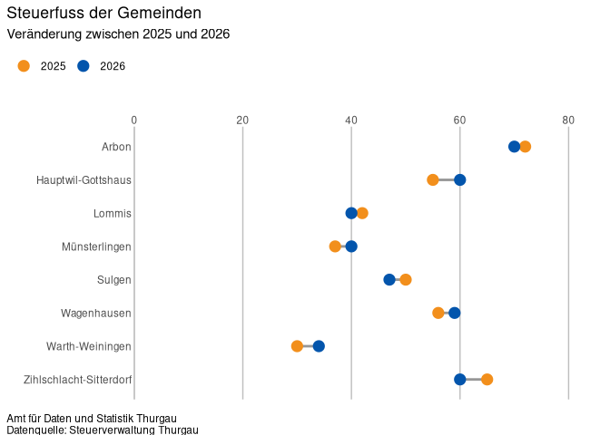

## <br>

<br>

##### Dubmbell-Chart mit schwarzen Labels

``` r
ggplot_dumbbell_full(
  data = tab_steuerfuss_change_long,
  x = "gemeindesteuerfuss",
  y = "gemeinde_name",
  x_min = "2025",
  x_max = "2026",
  reverse_y = TRUE,
  source = "Steuerverwaltung Thurgau",
  title = "Steuerfuss der Gemeinden",
  subtitle = "Veränderung zwischen 2025 und 2026",
  label = "gemeindesteuerfuss"
)
```

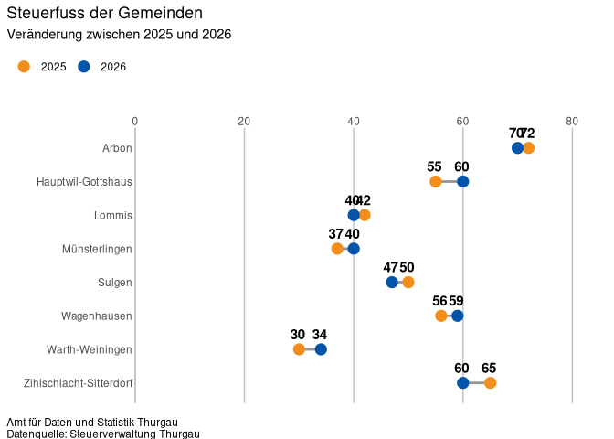

## <br>

<br>

##### Dubmbell-Chart mit farbigen Labels

``` r
ggplot_dumbbell_full(
  data = tab_steuerfuss_change_long,
  x = "gemeindesteuerfuss",
  y = "gemeinde_name",
  x_min = "2025",
  x_max = "2026",
  reverse_y = TRUE,
  source = "Steuerverwaltung Thurgau",
  title = "Steuerfuss der Gemeinden",
  subtitle = "Veränderung zwischen 2025 und 2026",
  label = "gemeindesteuerfuss",
  label_colour = "point",
  label_size = 4
)
```

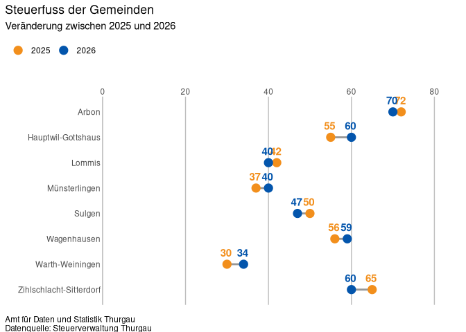

## <br>

<br>

### Lollipop-Grafik

##### Lollipop-Chart ohne Labels

``` r
ggplot_lollipop(data = tab_steuerfuss_aktuell,
                x = "gemeinde_name",
                y = "gemeindesteuerfuss",
                title = "TITEL",
                subtitle = "UNTERTITEL",
                source = "Steuerverwaltung Thurgau",
                size_point = 6,
                fill_palette = maincolors_discrete,
                fill_palette_name = "fillColor",
                fill_colors = 2,
                border_palette = border_discrete,
                border_palette_name = "borderColor",
                border_colors = 2)
```

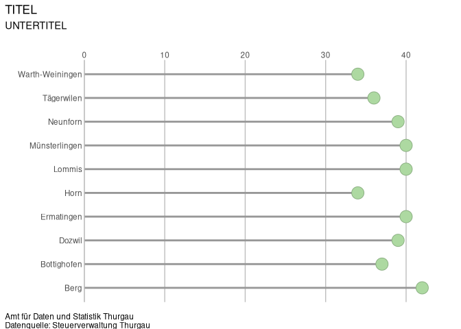

------------------------------------------------------------------------

##### Lollipop-Grafik mit Labels

``` r
ggplot_lollipop(data = tab_steuerfuss_aktuell,
                x = "gemeinde_name",
                y = "gemeindesteuerfuss",
                title = "TITEL",
                subtitle = "UNTERTITEL",
                source = "Steuerverwaltung Thurgau",
                size_point = 6,
                fill_palette = maincolors_discrete,
                fill_palette_name = "fillColor",
                fill_colors = 1,
                border_palette = border_discrete,
                border_palette_name = "borderColor",
                border_colors = 1,
                label = TRUE,
                label_colour = "point",
                label_size = 4)
```

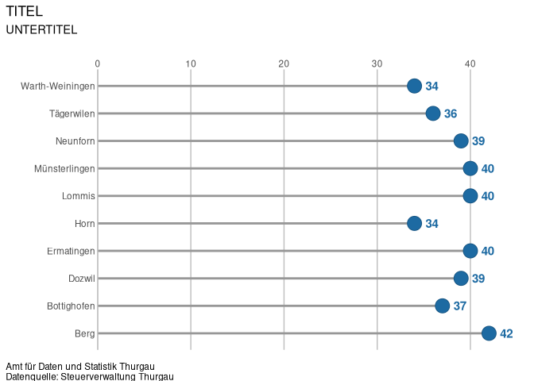

## <br>

<br>

## Kontakt

**Entwicklung & Support** Amt für Daten und Statistik Kanton Thurgau
